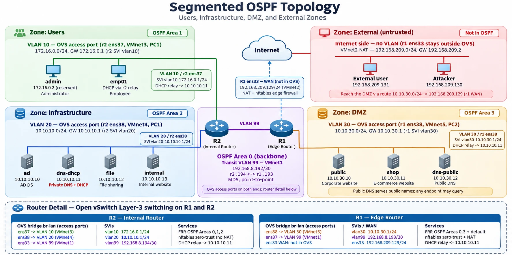

# Stage 01 · Segmented core network

The foundation every later stage builds on: four security zones as real **802.1Q VLANs**,
two Linux routers running **Open vSwitch**, **FRR/OSPF** and **default-deny nftables**,
plus the core services: Active Directory, split-horizon **BIND9** DNS, central **ISC
DHCP**, a file server, an intranet and two public websites.

## Contents

| Path | What it is |
|---|---|
| [`routers/r1-edge/`](routers/r1-edge) | Edge router: OVS script, FRR, nftables (NAT + zone policy), netplan, DHCP relay |
| [`routers/r2-internal/`](routers/r2-internal) | Internal router: same set, no NAT |
| [`routers/common/`](routers/common) | systemd unit and drop-ins for boot ordering |
| [`services/dns-dhcp/`](services/dns-dhcp) | Private BIND9 (options, zones, reverse zones) and `dhcpd.conf` |
| [`services/dns-public/`](services/dns-public) | Public BIND9 (options, public-only zone) |
| [`verification.md`](verification.md) | Test commands and expected results for this stage |

## 1. Layer 2: VLANs with Open vSwitch

Each router is a Layer-3 switch. Zone-facing NICs are untagged **access ports**; each VLAN
has a **switched virtual interface (SVI)** holding the gateway IP.

| Router | Port | Mode | SVI | Gateway IP |
|---|---|---|---|---|
| r1 | ens33 | WAN, outside OVS | none | 192.168.209.129 (DHCP from NAT) |
| r1 | ens37 | access, tag 99 | vlan99 | 192.168.8.193/30 |
| r1 | ens38 | access, tag 30 | vlan30 | 10.10.30.1/24 |
| r2 | ens33 | access, tag 99 | vlan99 | 192.168.8.194/30 |
| r2 | ens37 | access, tag 10 | vlan10 | 172.16.0.1/24 |
| r2 | ens38 | access, tag 20 | vlan20 | 10.10.10.1/24 |

- **SVIs reuse their NIC's MAC address**, so no host's ARP cache or config changed during
  the migration from flat networks to VLANs, and the hypervisor needs no promiscuous mode.
- **Persistence:** OVS stores bridges and tags itself, but SVI addresses do not survive a
  reboot. [`ovs-l3.sh`](routers/r1-edge/ovs-l3.sh) re-applies them from a oneshot
  [`ovs-l3.service`](routers/common/ovs-l3.service). [Drop-ins](routers/common/after-ovs.conf)
  start FRR and the DHCP relay after it. Netplan leaves switch ports unaddressed, and
  cloud-init's network config is disabled so it cannot rewrite netplan.

**Design decision: transit link.** An 802.1Q trunk was built first, but the hypervisor's
host-only network stripped and shifted the tag (tcpdump showed ethertype `0x2914`). Both
ends were switched to access mode in VLAN 99, and the link has worked since.

## 2. Layer 3: OSPF with FRR

| Area | Network | Router |
|---|---|---|
| 0 (backbone) | 192.168.8.192/30 transit | r1 + r2, **MD5-authenticated**, point-to-point |
| 1 | 172.16.0.0/24 Users | r2 (ABR) |
| 2 | 10.10.10.0/24 Infrastructure | r2 (ABR) |
| 3 | 10.10.30.0/24 DMZ | r1 (ABR) |

Zone interfaces are `passive` (advertised, no neighbours). r1 runs
`default-information originate`, so r2 learns the Internet route. Router IDs: 1.1.1.1 and
2.2.2.2. See [`r1-edge/frr.conf`](routers/r1-edge/frr.conf) and
[`r2-internal/frr.conf`](routers/r2-internal/frr.conf). The OSPF key in this repo is a
placeholder.

## 3. Zone firewalls (nftables on r1 and r2)

Stateful, default-deny `input` and `forward` chains, bound to the VLAN interfaces:

| Rule | r1 (edge) | r2 (internal) |
|---|---|---|
| Anti-spoofing | DMZ may only source 10.10.30.0/24; WAN may not claim any internal range | Users/Infra may only source their own subnet |
| Untrusted → internal | `R1-EXT-INTERNAL-DROP`, `R1-DMZ-INTERNAL-DROP` (logged) | `R2-UNTRUSTED-DROP` (logged) |
| Infra → Users | n/a | `R2-INFRA-USERS-DROP`: servers never start connections to workstations |
| Users → Infra | n/a | Only DNS, AD (Kerberos/LDAP/SMB/RPC), file share, intranet web, DHCP |
| Anyone → DMZ | Web 80/443 to public/shop, DNS 53 to dns-public | Users/Infra → DMZ web and public DNS |
| Management | SSH only from admin (172.16.0.2) | SSH only from admin; RDP only admin → AD |
| Control plane | OSPF (proto 89) only from r2 | OSPF only from r1 |
| Internet egress | 80/443 and NTP from internal zones, DNS only from dns-public; masquerade on WAN | via r1 |

Every remaining packet is dropped and logged at a limited rate (`R1-FWD-DROP`, `R2-IN-DROP`
and so on), so every block shows up as evidence.

**Accepted risk:** the Linux traceroute range (UDP 33434-33534) is accepted above the
anti-spoofing rules for full path visibility. The fix, if required, is to move it below
the zone drops.

## 4. Core services

| Host | IP | Service | Notes |
|---|---|---|---|
| ad | 10.10.10.10 | Windows Server, AD DS | Domain `corp.local`; DCs located through SRV records in the private DNS |
| dns-dhcp | 10.10.10.11 | BIND9 (private view) + ISC DHCP | Configs in [`services/dns-dhcp/`](services/dns-dhcp) |
| file | 10.10.10.12 | Samba file share | Users zone only (SMB 139/445) |
| internal | 10.10.10.13 | Dolibarr intranet (Apache) | Users zone only |
| public | 10.10.30.10 | Corporate website (Apache, WordPress) | Public |
| shop | 10.10.30.11 | E-commerce website (Apache, WordPress) | Public |
| dns-public | 10.10.30.12 | BIND9 (public view) | Configs in [`services/dns-public/`](services/dns-public) |

### Split-horizon DNS

Both servers are authoritative for `corp.local`, with **different contents**:

| | Private DNS (10.10.10.11) | Public DNS (10.10.30.12) |
|---|---|---|
| Records | Every host, routers, reverse zones, AD SRV records | Only `public`, `shop`, `www`, `dns-public` |
| Who may query | Users, Infra, transit (`acl trusted`) | Anyone |
| Recursion | Trusted clients; forwards to dns-public | Only for the private DNS and the DMZ; **not an open resolver** |
| Hardening | `allow-transfer { none; }`, version hidden | same, plus DNSSEC validation upstream |

An internal name resolves from inside and returns NXDOMAIN from outside, and outsiders
cannot even reach the private server (the router drops and logs it).

### DHCP

One ISC DHCP server for every zone. The Users pool is 172.16.0.20-200. Infra and DMZ use
reservations only, and DMZ clients are handed the **public** resolver. Clients in other
VLANs reach the server through `isc-dhcp-relay` on r2 (`vlan10 vlan20`) and r1
(`vlan30 vlan99`). The relay must also listen on the server-facing interface, or replies
are never relayed.

## 5. Verification

See [`verification.md`](verification.md). The key evidence: `ovs-appctl fdb/show br-lan`
(MACs learned per VLAN), `show ip ospf neighbor` (Full), `ip route | grep ospf` (routes are
learned, not static), and `journalctl -k | grep DROP` while attacking from outside.

## Problems solved

| Problem | Fix |
|---|---|
| r1 couldn't reach r2 over the trunk | Hypervisor corrupted 802.1Q tags; switched to access mode in VLAN 99 |
| OSPF stopped after moving IPs to SVIs | Re-bound OSPF to `vlan*` interfaces; enabled `ospfd` in `/etc/frr/daemons` on r1 |
| Users got no DHCP lease after the migration | Relay moved to SVI names and told to listen on `vlan20` too |
| IPs disappeared after reboot | `ovs-l3.service` + drop-ins; cloud-init network config disabled |
| `.local` lookups behaved oddly from Kali | `.local` is reserved for mDNS; always query the server explicitly (`dig @10.10.10.11`) |
