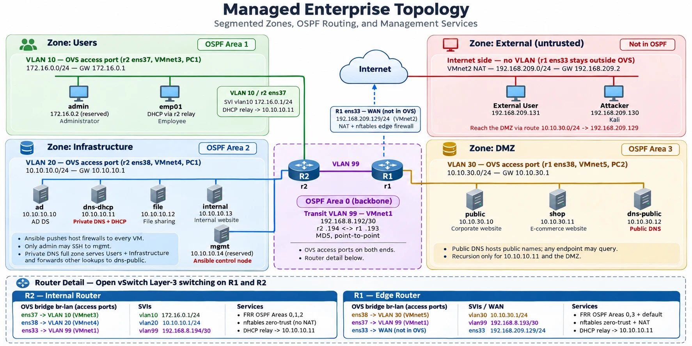

# Stage 02 · Host firewall automation

Stage 01 controls traffic **between** zones. This stage closes the gap **inside** each
zone: every server gets its own least-privilege firewall, so a compromised web server
cannot pivot to its neighbours. Linux firewalls are generated from one Ansible template,
and Windows firewalls are managed over WinRM or Group Policy.



## What changed from stage 01

| Change | Where |
|---|---|
| New VM **mgmt** (10.10.10.14), the Ansible control node | Infra zone |
| Default-deny nftables on every Linux server | [`ansible/`](ansible) |
| Windows Defender Firewall on AD and admin over WinRM; GPO for employee PCs | See *Windows hosts* below |
| One cross-zone router rule: mgmt → admin WinRM (5985) | [`routers/r2-additions.nft`](routers/r2-additions.nft) |
| Routers | Unchanged; they keep their stage-01 rulesets |

## Coverage

| Layer | Hosts | Firewall | Managed by |
|---|---|---|---|
| Linux servers | dns-dhcp, file, internal, public, shop, dns-public | nftables, default-deny in and out | `ansible-playbook site.yml` |
| Control node | mgmt | nftables (manages itself, `ansible_connection=local`) | `site.yml` |
| Domain controller | ad | Windows Defender Firewall | Ansible over WinRM (NTLM) |
| Admin workstation | admin | Windows Defender Firewall | Ansible over WinRM (NTLM) |
| Employee PCs | emp01 and any domain-joined client | Windows Defender Firewall | AD Group Policy |
| Routers | r1, r2 | nftables zone policy | Hand-managed (stage 01) |

## How the Linux template works

[`templates/nftables.conf.j2`](ansible/templates/nftables.conf.j2) renders three chains for
each host:

- **input** (`policy drop`): loopback, established/related, drop invalid, rate-limited
  ICMP, then `drop_rules` (logged as `<host>-BLOCK`, evaluated before any allow), SSH only
  from admin + mgmt, then the host's `inbound_rules`.
- **forward** (`policy drop`): endpoints never route.
- **output** (`policy drop`): DNS only to the zone's resolver (private DNS for Infra,
  public DNS for DMZ, set in `group_vars`), NTP, the DMZ DHCP renewal path, the host's
  `extra_outbound`, OS updates on 80/443 (toggle `allow_internet`), ICMP.

Every rendered file is checked with `nft -c` **before** it is written, so a mistake fails
the task instead of locking you out.

### Per-host policy

| Host | Inbound | Notable outbound / blocks |
|---|---|---|
| dns-dhcp | DNS from Users + Infra; DHCP from Users, DMZ, r1 relay | DNS forward to dns-public; DHCP replies to both relays; **SSH from admin blocked** (mgmt only) |
| dns-public | DNS from anyone | The only host allowed to recurse to 1.1.1.1 / 8.8.8.8 |
| file | SMB 139/445, NetBIOS 137/138 from Users | n/a |
| internal | HTTP/HTTPS from Users | n/a |
| public | HTTP/HTTPS from anyone, **25 req/s** | **Users subnet blocked** (policy: no internal browsing of the corporate site) |
| shop | HTTP/HTTPS from anyone, **25 req/s** | n/a |
| mgmt | none | SSH to Infra + DMZ; WinRM to AD and admin |

## Run it

```bash
cd ansible
ansible linux -m ping
ansible-playbook site.yml --check --diff          # preview
ansible-playbook site.yml --ask-vault-pass        # apply
ansible-playbook site.yml --limit dns-dhcp        # one host
sudo journalctl -k -f | grep -E "DROP|BLOCK"      # on a host: watch blocks
```

Windows credentials (`ansible_winrm_password`) and the sudo password live in Ansible Vault
(`group_vars/all/vault.yml`). That file is git-ignored and never committed.

### Windows hosts

The Windows playbooks, `windows.yml` for AD and `clients.yml` for admin, do four things.
They turn the firewall on for all profiles with inbound blocked by default. They allow
WinRM 5985 from mgmt only and RDP 3389 from admin only. They disable the built-in
any-source WinRM rule. AD keeps its Domain Controller rule groups so domain logon still
works. These playbooks are summarised here rather than included.

## Problems solved

| Problem | Fix |
|---|---|
| dns-public's upstream rule failed `nft -c` | Multiple addresses need an nft set: `{ 1.1.1.1, 8.8.8.8 }` |
| DHCP leases stopped after rollout (`send_packet: Operation not permitted`) | The server's own default-deny **output** chain dropped its replies; added replies to both relays and Users clients |
| WinRM `credentials rejected` | Basic auth fails for domain accounts; switched to NTLM |
| `powershell incompatible with sudo become` | `ansible_become=false` for Windows groups |
| WinRM blocked on admin | Adapter was on the Public profile; set it to Private |
| mgmt couldn't reach admin on 5985 | Needed both mgmt's outbound rule **and** the r2 forward rule |
| Fresh VMs `UNREACHABLE (publickey)` | `ssh-copy-id` from mgmt before the first run |
