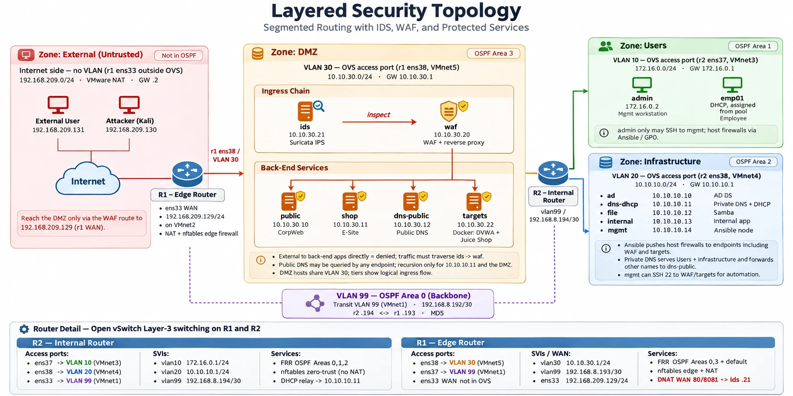

# Stage 03 · DMZ threat inspection (IPS + WAF)

Internet-facing web traffic no longer reaches application servers directly. It passes
through two inspection layers: a **Suricata inline IPS** at the network layer, then a
**ModSecurity v3 WAF** with the OWASP Core Rule Set at the application layer. Two
deliberately vulnerable apps, DVWA and OWASP Juice Shop, are the targets for proving it
works.



## Request path

```
attacker 192.168.209.130
  → r1 WAN 192.168.209.129     DNAT 80 / 8081 → ids
  → ids 10.10.30.21            Suricata on NFQUEUE 0: inspect, drop in-path; DNAT → waf, SNAT ← ids
  → waf 10.10.30.20            Nginx + ModSecurity v3 + OWASP CRS 3.3.5
  → targets 10.10.30.22        Docker: DVWA :8080, Juice Shop :3000
```

DVWA is published at `http://<r1-WAN>/` and Juice Shop at `http://<r1-WAN>:8081/`.

## What changed from stage 02

| Change | Where |
|---|---|
| New VM **ids**: Suricata 7 inline IPS, hand-managed (it forwards traffic) | [`ips/`](ips) |
| New VM **waf**: Nginx + ModSecurity + CRS, Ansible-managed endpoint | [`waf/`](waf), [`ansible-changes/host_vars/waf.yml`](ansible-changes/host_vars/waf.yml) |
| New VM **targets**: Docker host, hand-managed (Docker must forward) | [`app-backend/`](app-backend) |
| r1: Internet web traffic DNATed to the IPS; old direct WAN → web rule replaced | [`routers/r1-additions.nft`](routers/r1-additions.nft) |
| Attack test script | [`tests/attack-tests.sh`](tests/attack-tests.sh) |

## Layer 1: Suricata inline IPS (`ips/`)

- [`nftables.conf`](ips/nftables.conf): default deny. New flows to the WAF and all of
  their packets go to `queue num 0`. DNAT sends them on to the WAF, and **SNAT** makes
  the WAF reply back through the sensor (without it, routing is asymmetric and
  connections hang).
- [`systemd/suricata-ips.service`](ips/systemd/suricata-ips.service): runs `suricata -q 0`
  in place of the passive packaged service.
- [`config/suricata-snippet.yaml`](ips/config/suricata-snippet.yaml): ET Open plus local
  rules; `nfq: mode accept, fail-open yes`, which favours availability if Suricata stops.
- [`rules/local.rules`](ips/rules/local.rules): five custom signatures.

| SID | Detects | Action |
|---|---|---|
| 9000001 | `union … select` in the URI | drop |
| 9000002 | `<script` in the URI | drop |
| 9000003 | `../` path traversal | drop |
| 9000004 | `whoami` command injection | **alert only** (detect-versus-prevent contrast) |
| 9000005 | 20+ SYNs from one source in 5 s (port scan) | drop |

## Layer 2: ModSecurity WAF (`waf/`)

- [`modsecurity.conf`](waf/modsecurity/modsecurity.conf): engine **On**, request and
  response body inspection, audit log for relevant 4xx/5xx. Written by hand because the
  package ships no recommended config.
- [`main.conf`](waf/nginx/modsec/main.conf): include chain (base, then CRS setup, CRS
  rules, exclusions, then custom rules).
- [`custom.conf`](waf/nginx/modsec/custom.conf): five custom rules, IDs 100001-100005, for
  SQLi, XSS, traversal, command injection and scanner user agents (sqlmap, nikto, hydra,
  wpscan).
- [`sites-available/dvwa`](waf/nginx/sites-available/dvwa) and
  [`juice`](waf/nginx/sites-available/juice): protected reverse-proxy vhosts on 80 and 8081.

## Backend (`app-backend/`)

[`run-apps.sh`](app-backend/run-apps.sh) binds both containers to the DMZ address only.
The host [`nftables.conf`](app-backend/nftables.conf) accepts app ports **from the WAF
only** and allows `docker0` forwarding. Restart Docker after any nftables reload, because
`flush ruleset` removes Docker's chains.

## Results (from the external attacker)

| Request | Result | Stopped by |
|---|---|---|
| Browse DVWA / Juice Shop | `302` / `200` | allowed |
| `?id=1%20union%20select%201` | `000`, dropped in-path | Suricata 9000001 |
| `User-Agent: sqlmap/1.0` | `403` | ModSecurity 100005 |
| Direct to `10.10.30.22:8080` | `000` | Routers: no direct path into the DMZ backends |

Evidence: `tail -f /var/log/suricata/fast.log` on ids, `tail -f /var/log/modsec_audit.log`
on waf. Always use `curl -m5` for attack tests: an IPS drop looks like a hang.

## Design decisions

- **IPS and WAF on separate hosts:** "inspect, then terminate", with clean evidence for
  each layer.
- **Bare-metal security tools, containerised targets:** inline IPS needs host NFQUEUE, and
  the WAF config stays transparent. The vulnerable apps are fragile to install natively.
- **Forwarding hosts are hand-managed:** ids and targets must forward packets, which the
  stage-02 endpoint template forbids.
- **SNAT trade-off:** the WAF logs the sensor's IP instead of the client's. Correlate with
  Suricata's logs or use `X-Forwarded-For`.

## Problems solved

| Problem | Fix |
|---|---|
| `SecDefaultActions can only be placed once per phase` | Removed `SecDefaultAction` lines; the CRS defines them |
| Attacker saw "Welcome to nginx" | Removed `sites-enabled/default` |
| Suricata rejected a `pcre` rule | `\|` is special in rule syntax; used `content:` |
| "No rule files match" | Suricata loads from `/var/lib/suricata/rules/`, not `/etc/suricata/rules/` |
| r1: `unknown identifier 'IDS'` | `define` must come before first use |
| Chain hung after reloads | SNAT was only added live; persisted it in `/etc/nftables.conf` |
| WAF → backend timed out | Backend's `forward policy drop` blocked the Docker bridge; allowed `docker0` |
| `iptables: No chain/target DOCKER` | Never set `"iptables": false`; restart Docker after nftables reloads |
