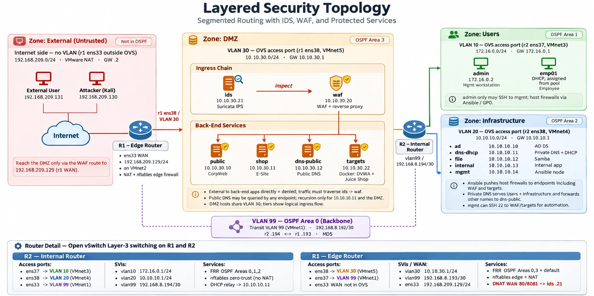

# Secure Enterprise Network

**A small enterprise network designed, built, hardened and attacked from scratch, one
security layer at a time.**

Two Linux routers, about 20 virtual machines, four security zones. Each stage folder adds
one capability on top of the previous one, with the **real configuration files**, a
**network diagram**, the **design reasoning**, the **verification evidence** and the
**problems hit along the way**.


---

## Current architecture



## How the network evolved

| Stage | Folder | What it adds | Key technologies | Status |
|---|---|---|---|---|
| 01 | [`01-segmented-core-network`](01-segmented-core-network) | 4 zones as real VLANs, dynamic routing, zone firewalls, AD, split-horizon DNS, DHCP | Open vSwitch, FRR/OSPF, nftables, BIND9, ISC DHCP, AD DS | ✅ Complete |
| 02 | [`02-host-firewall-automation`](02-host-firewall-automation) | Least-privilege firewall on every server, as code | Ansible, Jinja2, nftables, WinRM, GPO | ✅ Complete |
| 03 | [`03-dmz-threat-inspection`](03-dmz-threat-inspection) | Inline IPS + WAF in front of public web apps, tested with real attacks | Suricata, ModSecurity v3, OWASP CRS, Nginx, Docker | ✅ Complete |
| 04 | `04-secure-remote-access` *(coming soon)* | VPN, jump host, role-based access, private CA, HTTPS everywhere | OpenVPN, Easy-RSA, OpenSSH, Apache/Nginx TLS | 🔄 In progress |

Each stage is **additive**: nothing from an earlier stage is removed. A stage folder holds
the **new or changed** configuration for that stage, and files named `*-additions.nft`
show exactly which rules were added to an earlier ruleset.

## Security zones

| Zone | VLAN | Subnet | Gateway | Trust | Who lives here |
|---|---|---|---|---|---|
| Users | 10 | 172.16.0.0/24 | r2 · 172.16.0.1 | Trusted | Admin workstation, employee PCs |
| Infrastructure | 20 | 10.10.10.0/24 | r2 · 10.10.10.1 | Most trusted | Domain controller, DNS/DHCP, file server, intranet, Ansible node |
| DMZ | 30 | 10.10.30.0/24 | r1 · 10.10.30.1 | Semi-trusted | Public websites, public DNS, IPS, WAF, VPN, jump host |
| Transit | 99 | 192.168.8.192/30 | r1 .193 / r2 .194 | Router-only | OSPF backbone |
| External | none | 192.168.209.0/24 | NAT | Untrusted | Internet users, attacker (Kali) |

**Core rule:** External and DMZ can never *start* a connection into Users or
Infrastructure. Every such attempt is dropped **and logged** at the routers. The only
exceptions are narrow, explicit and documented: DHCP relay, and the jump host in stage 04.

Full host list: [`docs/addressing-and-inventory.md`](docs/addressing-and-inventory.md)

## Defence in depth

| Layer | Control | Stage |
|---|---|---|
| Network segmentation | 802.1Q VLANs, routed and filtered between zones | 01 |
| Perimeter and zone firewalls | Default-deny nftables, anti-spoofing, logged drops | 01 |
| Routing integrity | OSPF MD5 authentication, passive zone interfaces | 01 |
| Name-service exposure | Split-horizon DNS; public DNS is not an open resolver | 01 |
| Host firewalls | Default-deny in and out on every server, generated by Ansible | 02 |
| Network intrusion prevention | Suricata inline on NFQUEUE, custom signatures | 03 |
| Application firewall | ModSecurity + OWASP CRS, custom rules | 03 |
| Encryption in transit | Private CA, HTTPS on every website | 04 |
| Remote access | Certificate VPN, jump host, per-role egress rules | 04 |

## Guide for reviewers

**10 minutes:**
1. Look at the diagram above and the zone table.
2. Open [`03-dmz-threat-inspection`](03-dmz-threat-inspection): the request path, the
   custom IPS/WAF rules and the attack results table.
3. Skim the "Problems solved" table in any stage. That's where the real troubleshooting is.

**Going deeper:**
- Zone policy: [`r1 nftables`](01-segmented-core-network/routers/r1-edge/nftables.conf) and
  [`r2 nftables`](01-segmented-core-network/routers/r2-internal/nftables.conf)
- DNS: [`private BIND`](01-segmented-core-network/services/dns-dhcp) and
  [`public BIND`](01-segmented-core-network/services/dns-public)
- Automation: [`Ansible template`](02-host-firewall-automation/ansible/templates/nftables.conf.j2)
  and [`host_vars`](02-host-firewall-automation/ansible/host_vars)
- Evidence: [`docs/security-tests.md`](docs/security-tests.md), every control with its test
  and pass criteria

**Inside every stage folder:** `README.md` (what changed, why, results, problems) ·
`topology.webp` (network diagram) · the configuration files at the paths they live on the servers.

## Repository layout

```
secure-enterprise-network/
├── README.md                          ← you are here
├── docs/
│   ├── addressing-and-inventory.md    every host, IP, zone, role
│   └── security-tests.md              control-by-control test catalogue
├── 01-segmented-core-network/
│   ├── routers/{r1-edge,r2-internal,common}/
│   ├── services/{dns-dhcp,dns-public}/
│   └── verification.md
├── 02-host-firewall-automation/
│   ├── ansible/                       playbook, inventory, template, group/host vars
│   └── routers/r2-additions.nft
├── 03-dmz-threat-inspection/
│   ├── ips/  waf/  app-backend/  ansible-changes/  routers/  tests/
└── 04-secure-remote-access/          (coming soon)
    ├── vpn/  jump-host/  web-https/  routers/
```

## Environment

- Hypervisor: VMware Workstation. Each zone is its own virtual network, and VLANs are
  enforced by Open vSwitch on the routers.
- Routers and Linux servers: Ubuntu Server. Domain controller: Windows Server. Clients:
  Windows 10, plus Kali Linux as the attacker.
- Domain: `corp.local`.

## Sanitisation

All addresses are private lab ranges. Secrets are **not** in this repository: the OSPF key
is a placeholder (`CHANGE_ME_OSPF_KEY`), Ansible Vault files are git-ignored, and no
private keys or certificates are committed (see [`.gitignore`](.gitignore)).

## Roadmap

New capabilities are added as new numbered folders (`05-…`, `06-…`) with the same
structure, and this README's tables are updated. Planned next:
- Finish stage 04: VPN cut-over, RBAC proof, MITM and Kerberos Golden Ticket demonstrations
- Centralised logging and alerting for the drop logs, IPS alerts and WAF audit log
